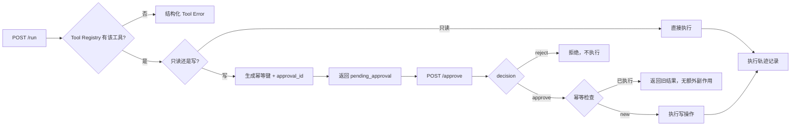

# Week5 Agent (Governed AI Workflow)

## 架构声明
- **独立应用层**：完全隔离于 week2-4 的历史代码资产。
- **依赖隔离**：不直接 `import` 旧代码，仅通过 `adapters/` 进行 HTTP 或 CLI 级别的薄封装调用。
- **确定性策略控制**：强制实施预算、超时、重试、死循环拦截等机制。

## 项目结构
- `tools/`：工具注册表（Registry）、Schema 校验、结构化错误（Error）
- `agent/`：Agent 核心循环（ReAct）与状态管理
- `adapters/`：外部能力薄契约（如 RAG 知识查询）
- `docs/`：技术决策记录与场景边界声明
- `tests/`：工程治理与安全拦截的自动化测试

## 可量化验证指标 (Day 1 验收标准)
- [x] 注册 ≥3 个工具（含名称、版本、权限、副作用、超时、重试、Schema）
- [x] 参数缺失、类型错误、枚举越界、范围越界均被 Schema 拦截
- [x] 工具名冲突检测通过；运行时工具投影只暴露允许工具
- [x] 结构化错误返回包含 `retryable`、`error_type`、`trace_id`
- [x] 决策记录覆盖 ≥10 项技术，四类判断（保留/抽取/舍弃/降级）齐全
- [x] `requirements.txt` 严格不出现 `chromadb`、`rank_bm25`、`ragas`

## 运行测试
```bash
pytest tests/test_registry.py -v

# Week5 Agent —— 治理版 Agent 最小可行闭环

## 1. 项目定位

week5 是治理版 Agent 最小可行闭环，核心能力包括：

- Tool Registry：工具名称、版本、权限、副作用、超时、重试、Schema。
- Schema 治理：参数缺失、类型、枚举、范围错误被拦截，返回结构化 Tool Error。
- ReAct 循环约束：最大步数、Run Deadline、单工具 Timeout、有限重试、循环检测。
- 写操作治理：幂等键 + 审批拦截 + 审批后 Resume + 重复调用无额外副作用。
- 执行轨迹分层归因：工具选择、参数生成、工具返回、忽略返回四层。
- 裸 ReAct vs 治理后 Agent 的指标对比。
- MCP Server/Client 演示入口保留在 `mcp_server/`。

week2–4 作为参考实现保留，week5 通过 adapter 复用其知识查询能力。

## 2. 运行方式

### 2.1 本地 venv（PowerShell）

要求：Python 3.11+。Docker 镜像使用 Python 3.11；本地 `.venv` 为 3.14.2，代码语法兼容两者。

```powershell
python -m venv .venv
.\.venv\Scripts\Activate.ps1
pip install -r requirements.txt
uvicorn app.main:app --host 0.0.0.0 --port 8000
```

### 2.2 Docker

```powershell
docker build -t week5-agent:day7 .
docker run -d --name week5-day7 -p 8000:8000 week5-agent:day7
docker ps
docker logs week5-day7
```

如果本机 8000 被占用，可改为 `-p 8001:8000`，后续验收命令把 `localhost:8000` 换成 `localhost:8001`。容器内 Uvicorn 监听 8000 不变。

### 2.3 验收命令（PowerShell）

健康检查：

```powershell
curl.exe http://localhost:8000/health
```

预期：

```json
{"status":"ok"}
```

只读工具直通：

```powershell
curl.exe -X POST http://localhost:8000/run -H "Content-Type: application/json" -d '{\"tenant_id\":\"t1\",\"user_id\":\"u1\",\"task_id\":\"task-001\",\"tool_name\":\"get_weather\",\"params\":{\"city\":\"Beijing\"}}'
```

预期：

```json
{"status":"executed","result":{"city":"Beijing","weather":"sunny","temperature_c":25,"trace_id":"trace-..."}}
```

写工具被审批拦截：

```powershell
curl.exe -X POST http://localhost:8000/run -H "Content-Type: application/json" -d '{\"tenant_id\":\"t1\",\"user_id\":\"u1\",\"task_id\":\"task-002\",\"tool_name\":\"send_email\",\"params\":{\"to\":\"a@example.com\",\"subject\":\"test\",\"body\":\"hello\"}}'
```

预期：

```json
{"status":"pending_approval","approval_id":"appr-xxxxxxxxxxxx","idempotency_key":"..."}
```

审批执行：

```powershell
curl.exe -X POST http://localhost:8000/approve -H "Content-Type: application/json" -d '{\"approval_id\":\"appr-xxxxxxxxxxxx\",\"decision\":\"approve\"}'
```

预期：

```json
{"status":"executed","result":{"to":"a@example.com","subject":"test","body":"hello","status":"sent","idempotency_key":"...","trace_id":"trace-..."}}
```

重复审批：

```powershell
curl.exe -X POST http://localhost:8000/approve -H "Content-Type: application/json" -d '{\"approval_id\":\"appr-xxxxxxxxxxxx\",\"decision\":\"approve\"}'
```

预期：不重复执行，返回状态不允许执行或幂等结果，例如：

```json
{"detail":"状态不允许执行: executed"}
```

## 3. 依赖

运行时依赖见 `requirements.txt`，版本已锁定：

- `fastapi==0.162.5`
- `uvicorn==0.54.0`
- `jsonschema==4.26.0`
- `pydantic==2.14.3`

说明：

- Python 版本：Docker 镜像使用 `python:3.11-slim`；本地 `.venv` 为 3.14.2，代码语法兼容。
- `pytest` 仅测试用，不进入运行镜像。
- `mcp` 仅 `mcp_server/` 的 stdio 演示入口使用，`app` 层不加载。
- week5 运行依赖不出现 `chromadb`、`rank_bm25`、`ragas`；week2–4 作为参考实现保留，week5 通过 adapter 复用其知识查询能力。
- 当前 `weather`、`send_email`、`submit_write_action` 均为纯内存实现，不发网络请求；LLM 以 `model_propose` 回调注入 `agent/loop.py`，`app` 层不调用任何模型。

## 4. week5 最小可行闭环图



如果 GitHub 不渲染 mermaid，按节点含义阅读即可：请求进入后先查 Tool Registry，只读直通，写工具生成幂等键和 `approval_id` 并拦截，审批通过后经幂等检查再执行，所有执行进入轨迹。

## 5. 场景约束与评估边界

### 5.1 能做的场景

- 只读工具直通执行，例如 `get_weather`。
- 写工具 100% 拦截，审批通过后 Resume 执行。
- 重复审批不产生额外副作用。
- 超时、429、5xx、空返回下走降级或有限重试，不卡死（以故障注入实验为准）。
- Schema 错误返回结构化 Tool Error，含 `retryable`、`error_type`。

### 5.2 不能做 / 不评估的场景

- 不评估真实邮件投递、真实支付、真实外部 API 的最终效果。
- 不评估多租户隔离的生产级实现，只验证 `tenant_id`、`user_id`、`task_id` 参与治理链路。
- 不评估大规模并发性能，只验证单机最小闭环。
- 不把 Coze/Dify 原型计入核心工程评估；它仅作为 FDE 附加技能。

### 5.3 评估只看

- 任务完成率、无效调用率、平均步数、超时恢复率。
- 审批拦截率、重复调用副作用次数。
- 执行轨迹分层错误率。

### 5.4 复现边界

依赖外部模型或下游服务时，需提供 mock 或故障注入模式。当前工具为纯内存实现，无外部网络依赖。

## 6. 指标对比

数据来源：`experiments/day6_bare_vs_governed.csv`。共 10 个任务，裸 ReAct 与治理后 Agent 各 10 个任务。

| 指标 | 裸 ReAct | 治理后 Agent | 数据来源 |
|---|---:|---:|---|
| 任务完成率 | 10.0% | 100.0% | day6_bare_vs_governed.csv |
| 无效调用率 | 0.0% | 0.0% | day6_bare_vs_governed.csv |
| 平均步数 | 1.00 | 1.90 | day6_bare_vs_governed.csv |
| 平均工具调用次数 | 1.00 | 1.40 | day6_bare_vs_governed.csv |
| 超时任务数 | 9 | 9 | day6_bare_vs_governed.csv |
| 超时恢复率 | 0.0% | 100.0% | day6_bare_vs_governed.csv |
| 平均延迟 | 0.0301s | 0.0517s | day6_bare_vs_governed.csv |

计算口径：

- 任务完成率 = `sum(success) / 10`。
- 无效调用率 = `sum(invalid_tool_calls) / sum(total_tool_calls)`。
- 平均步数 = `sum(total_steps) / 10`。
- 超时恢复率 = `sum(recovered_after_timeout) / sum(timed_out)`。
- 平均延迟 = `sum(latency_seconds) / 10`。

结论：治理后在任务完成率和超时恢复率上更优；无效调用率两者均为 0；平均步数和平均延迟上升，是治理层重试与降级带来的代价。样本为 10 个任务，结论边界有限。

## 7. 目录结构

```text
week5-agent/
├── adapters/                 # week2–4 能力适配层
├── agent/                    # ReAct 循环、model_propose 回调
├── app/
│   ├── main.py               # /health、/run、/approve 路由与治理分支
│   ├── schemas.py            # RunRequest、ApprovalRequest、PendingAction
│   └── idempotency.py        # 幂等键、指纹、幂等检查
├── config/                   # 配置
├── data/                     # 数据
├── docs/
│   ├── decision-log.md       # 技术融合决策表、冗余风险、失效条件
│   ├── scenario-boundary.md  # 场景锚点与评估边界
│   └── interview-qa.md       # 8 个追问回答草稿
├── experiments/
│   ├── day5_trace_attribution.csv
│   ├── day6_bare_vs_governed.csv
│   └── week5_final_report.md
├── mcp_server/               # MCP Server/Client stdio 演示
├── tests/                    # 单元测试，不进入运行镜像
├── tools/                    # 工具实现与 Schema 校验
├── day5_mock_tools.py
├── day5_pipeline.py
├── trace_logger.py
├── Dockerfile
├── .dockerignore
├── requirements.txt
├── pytest.ini
└── README.md
```

`.venv/`、`__pycache__/`、`.pytest_cache/` 为本地环境与缓存，不进入镜像。

## 8. 迁移说明

week2–4 作为参考实现保留，week5 通过 adapter 复用其知识查询能力。因此 week5 运行依赖清单不出现 `chromadb`、`rank_bm25`、`ragas`。

失效条件：若 adapter 确实直接使用上述依赖，必须在 `docs/decision-log.md` 说明“为什么本周必须保留”。旧项目接口不稳定时，改用 HTTP adapter，但仍不复制框架配置。

## 9. 决策与附加技能定位

- 技术融合决策、冗余与风险清单、所有“选 A 不选 B”的失效条件见 `docs/decision-log.md`。
- 场景锚点与评估边界见 `docs/scenario-boundary.md`。
- 8 个追问回答见 `docs/interview-qa.md`。
- Coze/Dify 定位为 FDE 附加技能，不替代核心工程产出；失效条件：岗位明确要求低代码平台为主产出时再调整。