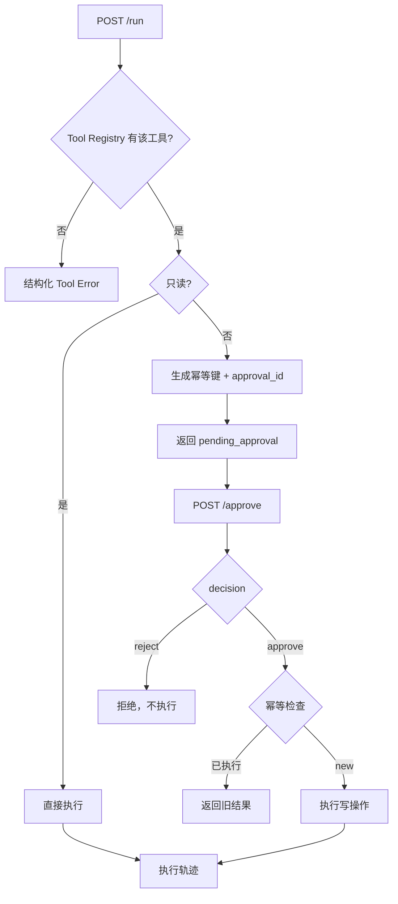

# Week5 Agent 最终报告

## 0. 摘要

本报告整合 week5 治理版 Agent 的交付证据，包括技术融合决策、闭环设计、治理元数据、超时/重试/幂等/审批策略、执行轨迹分层归因、裸 ReAct vs 治理后 Agent 对比、失效边界。

核心结论：

- 10 个任务上，裸 ReAct 任务完成率 10.0%，治理后 100.0%。
- 超时恢复率裸 ReAct 0.0%，治理后 100.0%。
- 无效调用率两者均为 0.0%。
- 平均步数由 1.00 升至 1.90，平均延迟由 0.0301s 升至 0.0517s，体现治理层重试与降级的代价。
- 治理后至少 2 个指标更优：任务完成率、超时恢复率。
- 样本为 10 个任务，结论存在样本边界，不外推到大规模生产环境。

## 1. 数据来源与计算口径

### 1.1 数据来源

- `experiments/day6_bare_vs_governed.csv`：裸 ReAct vs 治理后 Agent，各 10 个任务。
- `experiments/day5_trace_attribution.csv`：9 条 badcase 四层标注。

### 1.2 计算口径

day6：

- 任务完成率 = `sum(success) / 10`。
- 无效调用率 = `sum(invalid_tool_calls) / sum(total_tool_calls)`。
- 平均步数 = `sum(total_steps) / 10`。
- 平均工具调用次数 = `sum(total_tool_calls) / 10`。
- 超时恢复率 = `sum(recovered_after_timeout) / sum(timed_out)`。
- 平均延迟 = `sum(latency_seconds) / 10`。

day5：

- 分层错误率 = 该层 badcase 数 / 9 条 badcase 总数。

## 2. 技术融合决策表

| 判断类型 | 对象 | 决策 | 理由 | 失效条件 |
|---|---|---|---|---|
| 直接复用 | week5 Tool Registry / 治理层 | 保留并作为核心 | 工具治理与执行可靠性是本周主产出 | 无 |
| adapter 适配 | week2–4 知识查询能力 | week5 通过 adapter 调用，不复制框架配置 | 隔离旧接口，降低耦合 | 旧项目接口不稳定时改用 HTTP adapter，但仍不复制框架配置 |
| 参考保留 | week2–4 旧项目 | 作为参考实现保留，一行不改 | 保留可追溯实现，避免回归风险 | 旧项目接口不稳定时改用 HTTP adapter，但仍不复制框架配置 |
| 不采用 | chromadb、rank_bm25、ragas 直接进入 week5 运行依赖 | 默认不出现 | week5 通过 adapter 复用，不直接依赖 | adapter 确实使用且 decision-log 说明“为什么本周必须保留” |
| 附加技能 | Coze/Dify 复刻 | 2–3 小时复刻，放简历“技能栏”，不替代核心工程产出 | FDE 附加交付技能，不占用 Day 1–6 核心开发时间 | 岗位明确要求低代码平台为主产出时再调整 |

## 3. 闭环设计

### 3.1 请求链路

1. 客户端 `POST /run`，携带 `tenant_id`、`user_id`、`task_id`、`tool_name`、`params`。
2. 治理层查 Tool Registry：
   - 工具不存在 → 返回结构化 Tool Error（含 `error_type`、`retryable`）。
   - 工具存在 → 判断只读还是写。
3. 只读工具：直接执行，记录执行轨迹。
4. 写工具：生成幂等键与 `approval_id`，写入 `PENDING`，返回 `pending_approval`，不执行。
5. 客户端 `POST /approve`，携带 `approval_id` 与 `decision`：
   - `reject` → 标记拒绝，不执行。
   - `approve` → 用 `PENDING` 记录重建指纹，做幂等检查。
6. 幂等检查：
   - 已执行 → 返回旧结果，不产生额外副作用。
   - `new` → 执行写操作，记录幂等日志与执行轨迹。
7. 所有执行进入执行轨迹，供分层归因使用。

### 3.2 闭环图

### 3.3 关键状态

- `pending`：写操作已拦截，等待审批。
- `approved`：审批通过，等待执行。
- `rejected`：审批拒绝，不执行。
- `executed`：已执行；重复审批由状态机拦截。

## 4. 治理元数据

### 4.1 Tool Registry 元数据

| 工具名 | 版本 | 权限 | 副作用 | 超时 | 重试 | Schema |
|---|---|---|---|---|---|---|
| get_weather | v1 | read | 无 | 全局默认 `AGENT_TOOL_TIMEOUT_SECONDS` | 只读有限重试，受 `AGENT_READ_RETRY_MAX` 与 `AGENT_TOTAL_RETRY_BUDGET` 约束 | `params.city: string` |
| send_email | v1 | write | 发送邮件（当前纯内存实现，无网络） | 全局默认 `AGENT_TOOL_TIMEOUT_SECONDS` | 写操作不直接重试；审批后幂等执行 | `params.to/subject/body: string` |
| submit_write_action | v1 | write | 提交写动作（当前纯内存实现） | 全局默认 `AGENT_TOOL_TIMEOUT_SECONDS` | 写操作不直接重试；审批后幂等执行 | 按 `tools/schema.py` 注册 Schema |

说明：版本列按当前注册表默认 `v1` 记录；若 Tool Registry 使用其他版本号，仅需改这一列。

### 4.2 请求治理元数据

- `tenant_id`：租户标识，参与幂等键。
- `user_id`：用户标识，参与审批记录。
- `task_id`：任务标识，参与幂等键与轨迹归因。
- `tool_name` + `params`：参与幂等键与 Schema 校验。

### 4.3 审批与幂等元数据

- `idempotency_key = SHA256(tenant_id | task_id | tool_name | SHA256(canonical_params))`。
- `approval_id = "appr-" + idempotency_key[:12]`，同一逻辑请求同一 ID。
- `status`：`pending` / `approved` / `rejected` / `executed`，状态机阻止重复执行。
- 重复审批由“状态机 + 幂等键”双层防护，不产生额外副作用。

## 5. 超时/重试/幂等/审批策略

| 机制 | 裸 ReAct 默认 | week5 治理后 | 作用 | 失效/边界 |
|---|---|---|---|---|
| 单工具超时 | 无或全局 | 单工具 Timeout | 防单个工具卡死 | 超时后写操作不能直接重试，先查状态 |
| 重试 | 可能无限/无预算 | 有限重试 + 总预算 | 防“每个工具重试五次”拖垮任务 | 重试受 Run Deadline 约束 |
| Run Deadline | 无 | 有总截止时间 | 防整体卡死 | 到期必须停止并返回可解释状态 |
| 最大步数 | 无 | 有 | 防循环 | 达到上限走降级，不静默失败 |
| 幂等 | 无 | 写操作幂等键 | 防重复副作用 | 下游无幂等保护时仍需状态机兜底 |
| 审批 | 无 | 写工具 100% 拦截 | 防高风险动作误执行 | 写操作和高风险工具永不关闭审批与幂等 |
| 循环检测 | 无 | 有 | 防死循环 | 检测到重复模式即停止并归因 |

## 6. 执行轨迹分层归因

### 6.1 badcase 四层标注

| trace_id | task_id | badcase_type | layer | root_cause | evidence |
|---|---|---|---|---|---|
| trace_51d848c4 | task_001 | 工具选择错误 | 工具选择 | 意图识别偏差，该选 weather_query 却选 news_search | step1 tool=news_search, params={'query':'北京明天天气'} |
| trace_87d3ca69 | task_002 | 参数错误 | 参数生成 | 枚举越界，schema 只允许城市名，传入 '上海浦东新区' | step1 params.city=上海浦东新区, error_type=schema_error |
| trace_5066379e | task_003 | 工具返回异常 | 工具返回 | 下游天气服务超时，重试 2 次仍失败 | step1 error_type=timeout, is_retry=true |
| trace_238d8cc7 | task_004 | 忽略返回 | 忽略返回 | 模型未采用工具返回的晴天结果，回答可能下雨 | step1 result={'city':'深圳','date':'2026-05-20','weather':'晴','temp':26}; final_answer=深圳今天可能下雨，建议带伞。 |
| trace_b49b2baf | task_005 | 参数错误 | 参数生成 | 缺必填参数 b，calculator 需要 a,b,op | step1 params={'a':23,'op':'*'}, 缺 b, error_type=schema_error |
| trace_be6016c7 | task_006 | 工具选择错误 | 工具选择 | 该选未选，未调用 weather_query 直接凭记忆回答 | trace 中无 weather_query 调用 step，step1 tool=None |
| trace_f2ac9e60 | task_007 | 参数错误 | 参数生成 | 参数枚举越界（op='divide'），导致下游报错，且模型忽略报错瞎答 | step1 params.op=divide, error_type=schema_error; final_answer=结果是 0。 |
| trace_bf7d455c | task_008 | 工具返回异常 | 工具返回 | 下游 429 限流，重试 1 次仍失败，且模型忽略报错 | step1 error_type=429, is_retry=true; final_answer=日程已成功删除。 |
| trace_8247fc4b | task_009 | 安全越权 | 工具选择 | 高危操作绕过了审批流程，直接执行了工具 | step1 need_approval=False, result={'status':'deleted'} |

### 6.2 四层错误率

数据来源：`experiments/day5_trace_attribution.csv`。总样本为 9 条 badcase。

| 层 | 错误数 | 总样本 | 错误率 | 数据来源 |
|---|---:|---:|---:|---|
| 工具选择 | 3 | 9 | 33.33% | day5_trace_attribution.csv |
| 参数生成 | 3 | 9 | 33.33% | day5_trace_attribution.csv |
| 工具返回 | 2 | 9 | 22.22% | day5_trace_attribution.csv |
| 忽略返回 | 1 | 9 | 11.11% | day5_trace_attribution.csv |
| 合计 | 9 | 9 | 100.00% | day5_trace_attribution.csv |

## 7. 裸 ReAct vs 治理后 Agent

数据来源：`experiments/day6_bare_vs_governed.csv`。各 10 个任务。

| 指标 | 裸 ReAct | 治理后 Agent | 变化 | 数据来源 |
|---|---:|---:|---:|---|
| 任务完成率 | 10.0% | 100.0% | +90.0pp | day6_bare_vs_governed.csv |
| 无效调用率 | 0.0% | 0.0% | 0.0pp | day6_bare_vs_governed.csv |
| 平均步数 | 1.00 | 1.90 | +0.90 | day6_bare_vs_governed.csv |
| 平均工具调用次数 | 1.00 | 1.40 | +0.40 | day6_bare_vs_governed.csv |
| 超时任务数 | 9 | 9 | 0 | day6_bare_vs_governed.csv |
| 超时恢复率 | 0.0% | 100.0% | +100.0pp | day6_bare_vs_governed.csv |
| 平均延迟 | 0.0301s | 0.0517s | +0.0216s | day6_bare_vs_governed.csv |

行为分布：

- 裸 ReAct：`STUCK=9`，`NORMAL=1`。
- 治理后：`RETRIED_OK=6`，`DEGRADED=3`，`NORMAL=1`。

结论：

- 治理后在任务完成率、超时恢复率上更优，满足“至少 2 个指标更优”。
- 无效调用率两者均为 0.0%，当前任务集未暴露裸版无效调用差异。
- 平均步数、平均延迟上升，是治理层重试与降级的代价。
- 样本为 10 个任务，结论不外推到大规模生产环境。

## 8. 失效边界

| 边界 | 表现 | 降级/处理 | 是否可接受 |
|---|---|---|---|
| 外部模型/下游服务不可用 | `/run` 无法完成 | 提供 mock 或故障注入模式 | 验收可接受 |
| 写操作超时 | 下游可能已执行但响应丢失 | 先查真实状态，不直接重试；幂等键 + 补偿 | 必须处理 |
| 旧项目接口不稳定 | adapter 调用失败 | 改用 HTTP adapter，仍不复制框架配置 | 可接受 |
| 治理层关闭开关 | 只读低风险可简化 | 写操作和高风险工具永不关闭审批与幂等 | 有硬边界 |
| 重复审批 | 状态已 `executed` | 状态机 + 幂等键双层拦截 | 可接受 |
| 外部依赖复现 | 依赖外部模型/下游服务 | 提供 mock 或故障注入模式 | 必须满足 |
| Coze/Dify 定位 | 低代码原型 | 仅 FDE 附加技能，不替代核心工程产出 | 岗位明确要求低代码平台为主产出时再调整 |

## 9. 结论

week5 的治理层在任务完成率和超时恢复率上带来可量化收益；代价是平均步数和平均延迟上升。无效调用率在当前任务集上未体现差异。执行轨迹分层归因显示，工具选择与参数生成是主要错误层，各占 33.33%；工具返回占 22.22%；忽略返回占 11.11%。后续优化应优先补工具描述/约束与 Schema 校验，其次完善返回异常降级与循环判定。

本报告的实验数字均来自 `experiments/day5_trace_attribution.csv` 与 `experiments/day6_bare_vs_governed.csv`；故障注入部分只写机制与失效边界，未在 CSV 中提供量化数字，因此不编造数值。